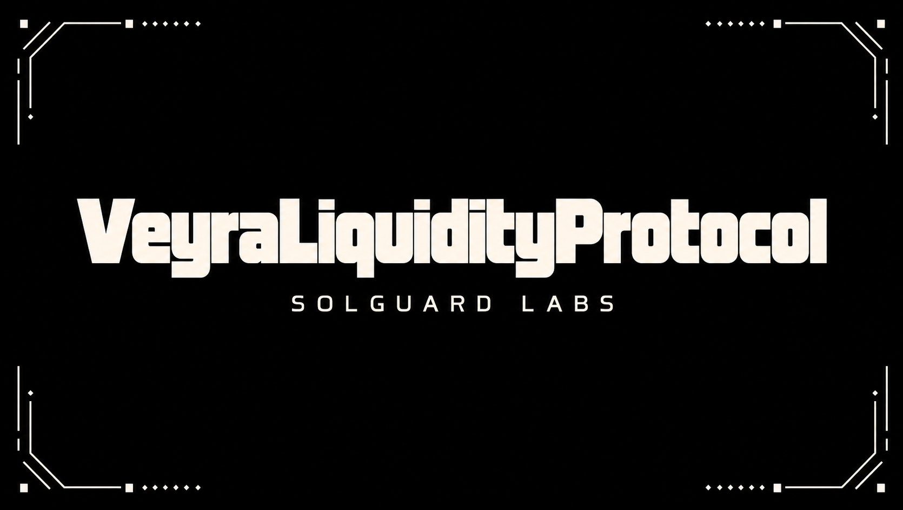
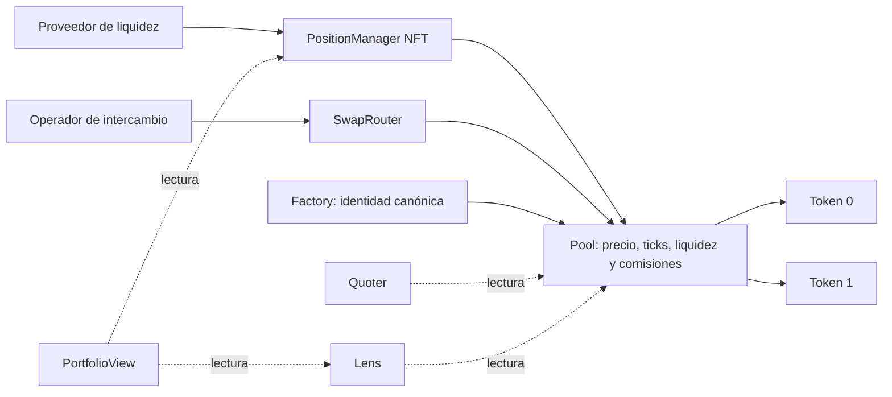

# Veyra Liquidity Protocol



Veyra es un protocolo de liquidez concentrada para pares ERC-20. El sistema permite a
los proveedores asignar capital a intervalos de precio concretos, intercambiar activos
contra la liquidez activa y gestionar posiciones tokenizadas mediante una interfaz
orientada a integraciones.

La implementación está diseñada como un conjunto de contratos modulares. La separación
entre núcleo y periferia mantiene la contabilidad del pool aislada de la experiencia de
usuario, las consultas y la custodia de posiciones.

## Modelo del protocolo

Cada pool mantiene un precio y organiza la liquidez por rangos de ticks. Un rango se
expresa como `[lower, upper)`: el límite inferior está incluido y el superior queda
excluido. Una posición aporta liquidez mientras el tick actual satisface
`lower <= tick < upper`.

Las comisiones de intercambio se cobran sobre el activo de entrada. Su crecimiento se
representa mediante acumuladores de precisión fija Q128, lo que permite distribuir
fracciones de comisión entre posiciones sin perder precisión en cada operación. Las
cantidades realizables se materializan cuando se actualiza o cobra una posición.

El rebalanceo es manual. El propietario elige un nuevo rango y define límites de
ejecución; el gestor retira la liquidez del intervalo anterior y la despliega en el
nuevo según el estado vigente del pool. El protocolo no presupone una estrategia
automática ni delega decisiones de mercado.

## Componentes

- **Factory**: registra la configuración compartida, crea pools canónicos por par y
  comisión, y evita duplicados para una misma combinación.
- **Pool**: conserva precio, liquidez activa, rangos inicializados y crecimiento de
  comisiones. Ejecuta swaps, altas y bajas de liquidez y liquidación de cantidades
  pendientes.
- **PositionManager NFT**: representa cada posición como un NFT, valida la titularidad
  y coordina creación, aumento, reducción, cobro y rebalanceo.
- **SwapRouter**: ofrece una entrada ergonómica para swaps exact-input y exact-output,
  con controles de importe mínimo, máximo, destinatario y plazo.
- **Quoter**: simula resultados de intercambio sin modificar el estado y devuelve
  importes, precio posterior y datos de ejecución relevantes.
- **Lens**: agrega lecturas de pools, rangos y posiciones para clientes, indexadores y
  herramientas operativas.
- **PortfolioView**: reúne titularidad NFT, principal estimado y comisiones observables
  en lotes de lectura, sin permisos de escritura ni custodia.



La arquitectura, las fórmulas de distribución y los límites de integración se
desarrollan en [docs/](./docs/README.md).

## Flujo básico

1. La Factory crea o localiza el pool canónico para dos tokens, un espaciado de ticks y
   una comisión.
2. El proveedor aprueba los tokens y crea una posición NFT con un rango válido.
3. El PositionManager deposita las cantidades necesarias y registra la liquidez.
4. Los usuarios intercambian activos a través del SwapRouter.
5. El proveedor puede cobrar comisiones, modificar liquidez o moverla manualmente a un
   rango distinto.
6. Quoter y Lens permiten preparar transacciones y observar el estado sin custodia.

## Requisitos

- [Foundry](https://book.getfoundry.sh/) con `forge`, `cast` y `anvil`.
- Solidity `0.8.24`, gestionado automáticamente por Foundry.
- Git y Bash para ejecutar los scripts de automatización.

No se necesitan nodos externos ni servicios de terceros para compilar o ejecutar la
suite local.

## Instalación

Clona el repositorio y, si el checkout incluye dependencias como submódulos,
inicialízalas:

```bash
git submodule update --init --recursive
forge build
```

## Compilación y tests

```bash
forge fmt --check
forge build
forge test
```

Los scripts del repositorio ofrecen los mismos puntos de entrada utilizados en CI:

```bash
bash scripts/tests.sh
bash scripts/ci.sh
```

Se pueden pasar argumentos adicionales de Forge a la suite rápida:

```bash
bash scripts/tests.sh --match-contract PositionManagerTest -vvv
```

## Integración de cartera

`VeyraPortfolioView.batch(ids)` devuelve filas en el orden de los IDs solicitados.
Cada fila contiene propietario, pool, rango, liquidez, importes de principal y
comisiones observables. Es una consulta: no mueve activos ni altera posiciones.
Conviene paginar los IDs para mantener acotado el tamaño de respuesta RPC. Las
cantidades son una fotografía del bloque consultado, no una garantía de ejecución.

## Despliegue de referencia

El script principal despliega la Factory y la periferia canónica. Si se definen
`VEYRA_TOKEN_A` y `VEYRA_TOKEN_B`, también crea e inicializa el primer pool:

```bash
forge script script/DeployVeyra.s.sol:DeployVeyra \
  --rpc-url "$RPC_URL" \
  --broadcast
```

La orden anterior transmite transacciones; ejecútala únicamente en un entorno de
pruebas controlado. El script lee `PRIVATE_KEY` y acepta las variables opcionales `VEYRA_ADMIN`,
`VEYRA_FEE_RECIPIENT`, `VEYRA_FEE_PIPS` y `VEYRA_INITIAL_SQRT_PRICE_X96`.

## Estructura

```text
.
├── src/
│   ├── VeyraFactory.sol
│   ├── VeyraPool.sol
│   ├── interfaces/    # Interfaces públicas
│   ├── libraries/     # Matemáticas, ticks y utilidades contables
│   ├── mocks/         # Activos auxiliares para tests
│   ├── periphery/     # Gestor NFT, router, quoter y vistas
│   ├── types/         # Tipos compartidos
│   └── utils/         # Primitivas reutilizables
├── test/              # Tests unitarios, fuzz e invariantes
├── script/            # Scripts de despliegue y escenarios
├── scripts/           # Entradas reproducibles para test y CI
├── .github/           # Automatización de integración y dependencias
├── docs/              # Arquitectura, economía, integración y operaciones
└── foundry.toml       # Configuración de compilación y pruebas
```

## Criterios operativos

- Los pares se normalizan para conservar una identidad canónica.
- Los rangos deben respetar el orden, los límites y el espaciado configurado.
- Los swaps aplican protección de precio y límites de cantidad definidos por el
  llamante.
- Las operaciones de periferia incluyen destinatario y plazo explícitos.
- Las lecturas de Quoter y Lens no custodian fondos ni conceden permisos.
- Los cambios de parámetros administrativos quedan acotados por los roles definidos en
  el protocolo.

## Desarrollo

Antes de proponer cambios:

```bash
bash scripts/ci.sh
```

Los cambios en matemáticas, ticks, liquidez o comisiones deben incluir tests de frontera
y, cuando corresponda, casos fuzz o invariantes. La política de reporte y el alcance de
seguridad se detallan en [SECURITY.md](./SECURITY.md).

## Licencia

Los archivos fuente declaran licencia MIT mediante identificadores SPDX.
