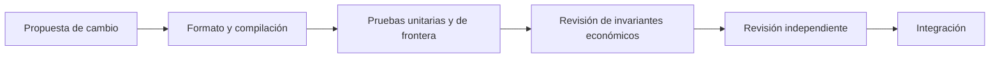

# Política de seguridad

Veyra Liquidity Protocol modela infraestructura financiera on-chain. Los cambios en
precio, liquidez, rangos, comisiones o custodia deben conservar las propiedades
económicas del sistema y mantener un comportamiento determinista para una misma
secuencia de transacciones.

## Alcance

La revisión de seguridad cubre:

- creación y configuración canónica de pools;
- inicialización y transición del precio;
- activación de liquidez por rango;
- swaps exact-input y exact-output;
- creación, transferencia y gestión de posiciones NFT;
- aumento, reducción y cobro de posiciones;
- rebalanceo manual y controles de ejecución;
- crecimiento y distribución de comisiones;
- permisos, pausas y parámetros administrativos;
- resultados de Quoter y agregaciones de Lens;
- composición de vistas de cartera y límites de lectura por lotes;
- interacciones ERC-20 realizadas por la periferia.

Los despliegues de terceros, interfaces web, indexadores externos, oráculos no
incluidos en el repositorio y la custodia de claves quedan fuera del alcance del
proyecto.

## Invariantes esperadas

Las revisiones y pruebas deben comprobar, como mínimo:

- un par y una configuración identifican un único pool canónico;
- la liquidez solo está activa dentro del intervalo configurado;
- las transiciones de precio respetan los límites indicados por el llamante;
- los balances transferidos corresponden a los importes contabilizados;
- las comisiones crecen de forma monotónica y se distribuyen según la liquidez
  participante;
- cualquier transición de rango debe conservar coherencia entre liquidez económica,
  checkpoints y pasivos cobrables;
- reducir liquidez no puede retirar más principal del asociado a la posición;
- solo una cuenta autorizada puede operar sobre una posición NFT;
- las operaciones vencidas o con límites de slippage incumplidos revierten;
- Quoter y Lens no modifican estado ni custodian activos;
- las pausas y cambios administrativos respetan la separación de roles.

## Supuestos sobre tokens

El protocolo se prueba con ERC-20 de transferencia estándar. Las integraciones con
tokens deflacionarios, rebasing, con callbacks arbitrarios o con retornos no estándar
requieren una evaluación específica antes de habilitarse. No deben emplearse activos
reales en despliegues de prueba.

## Validación automatizada

Todo cambio debe superar:

```bash
forge fmt --check
forge build
forge test
```

La configuración de CI amplía las ejecuciones fuzz e invariantes. Los cambios sobre
matemáticas, contabilidad o permisos deben aportar casos nominales, fronteras y
rechazos explícitos.



La automatización no sustituye la revisión independiente. Ninguna lectura agregada
autoriza una operación: el contrato gestor vuelve a verificar permisos y límites al
ejecutarla.

## Gestión de dependencias

- Foundry fija la versión de Solidity en `0.8.24`.
- Las dependencias externas deben quedar declaradas y ser reproducibles.
- GitHub Actions se revisa mediante Dependabot.
- Una actualización de toolchain o dependencia debe ejecutar la suite completa.
- No se aceptan dependencias de red durante la ejecución normal de los contratos.

## Reporte responsable

Los hallazgos deben comunicarse de forma privada al mantenedor mediante el canal
acordado para el repositorio. El reporte debería incluir:

- descripción del comportamiento observado;
- contrato y función afectados;
- condiciones previas y pasos de reproducción;
- impacto técnico y económico estimado;
- trazas o tests mínimos que permitan validarlo;
- propuesta de corrección, si está disponible.

No publiques pruebas de concepto, trazas completas ni detalles explotables antes de
coordinar una revisión con el mantenedor.

## Criterios de aceptación

Una corrección de seguridad debe preservar compatibilidad pública cuando sea posible,
añadir una prueba de regresión, documentar cualquier cambio de invariante y superar
`bash scripts/ci.sh`. Los cambios sensibles requieren revisión independiente antes de
integrarse.

