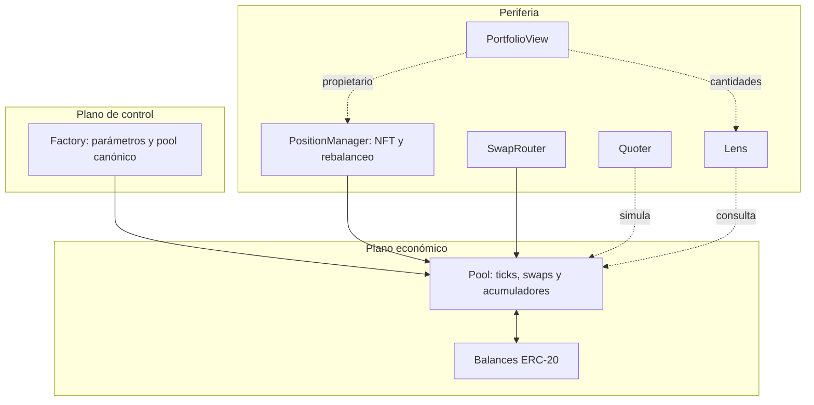

# Arquitectura

Veyra separa el registro de pools, la máquina económica y la periferia. Factory
normaliza la identidad del par; Pool conserva precio, ticks, liquidez activa,
inventario y acumuladores; PositionManager tokeniza posiciones y coordina las
operaciones multietapa. Router adapta swaps a límites de usuario. Quoter, Lens y
PortfolioView son rutas de consulta: no conceden permisos de gasto.

## Estados y límites

Un pool se inicializa antes de admitir liquidez. El tick actual determina qué
rangos participan en el swap. La posición NFT acredita la facultad de cambiar
liquidez, cobrar y rebalancear; consultar el NFT no reemplaza la autorización
comprobada al ejecutar. Los callbacks de mint y swap se originan en la operación
de periferia y deben respetar el pool esperado y el pagador indicado.

El rebalanceo se efectúa dentro de una transacción: retirada del rango inicial,
eventual ajuste de inventario y compromiso del nuevo rango. La atomicidad EVM
evita un estado parcialmente confirmado entre transacciones, pero cada fase
modifica magnitudes económicas; una integración no debe tratar una cotización
previa como saldo garantizado.
