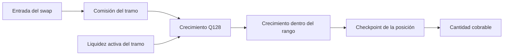

# Modelo económico

Una posición se identifica por pool, rango `[tickLower, tickUpper)`, sal y NFT.
Solo aporta liquidez al precio marginal cuando `tickLower <= tick < tickUpper`.
Fuera de rango mantiene exposición a un solo activo según el lado del precio.

## Liquidez y cantidades

Con `P_a < P_b` y precio `P`, la liquidez `L` representa cantidades diferentes
según si `P` queda por debajo, dentro o por encima del rango. Dentro del rango,
en términos ideales y antes de redondeos:

```text
amount0 ≈ L × (sqrt(P_b) − sqrt(P)) / (sqrt(P) × sqrt(P_b))
amount1 ≈ L × (sqrt(P) − sqrt(P_a))
```

La ejecución usa enteros y precio en formato fijo Q96; la biblioteca de cálculo
aplica el redondeo correspondiente al sentido de la transferencia. Por eso una
vista decimal no sustituye los importes exactos de la transacción.

## Comisiones

Para entrada bruta `A` y comisión `f` en partes por millón, la comisión nominal
es `A × f / 1_000_000`, sujeta al redondeo de la ruta de swap. El crecimiento
por unidad de liquidez se representa en Q128:

```text
growthDelta = feePaid × 2^128 / activeLiquidity
positionFee ≈ positionLiquidity × insideGrowthDelta / 2^128
```

La distribución depende de la liquidez participante en cada tramo de precio.
Al cruzar ticks, cambia el conjunto de posiciones activas. Los acumuladores
permiten diferir el cómputo individual hasta la actualización o el cobro.



## Riesgos de mercado y contabilidad

Un LP asume variación de composición, deslizamiento y pérdida frente a mantener
los activos fuera del pool. Los límites de precio y cantidad reducen la exposición
de una orden concreta; no garantizan rentabilidad. Las comisiones cobrables son
un pasivo del pool frente a posiciones y deben poder reconciliarse con balances
efectivos. Al cambiar de rango, la exposición y el checkpoint asociado a cada
posición deben interpretarse en la misma fase temporal.
