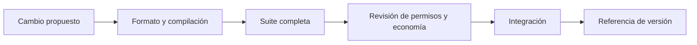

# Operaciones y controles

## Validación de cambios

La ruta mínima de integración ejecuta `forge fmt --check`, `forge build` y
`forge test`. Los cambios a bibliotecas matemáticas o contabilidad de pool
requieren casos de frontera, fuzzing y revisión de conservación de saldos.
Las pruebas de las vistas deben comprobar orden, propietario y rechazo de
dependencias inválidas; una vista no reemplaza las pruebas transaccionales.

## Parámetros y credenciales

La Factory y los componentes administrativos deben desplegarse con direcciones
verificadas y bajo un esquema de custodia de claves apropiado para el entorno.
El script `DeployVeyra.s.sol` lee `PRIVATE_KEY`; nunca debe guardarse en el
repositorio, en logs de CI ni en documentación. Las variables opcionales del
script se registran junto a las direcciones resultantes para que una operación
sea reproducible. No se presupone un despliegue público por el mero hecho de
crear una versión del código.

## Observabilidad

Un monitor operativo debe seguir balances del pool, liquidez activa, ticks,
crecimiento global de comisiones, claims pendientes y eventos de gestión de
NFT. Los cambios de administración y la aparición de pools nuevos necesitan
alertas separadas. Las lecturas de Lens y PortfolioView permiten inspección,
pero la conciliación crítica debe contrastarse con el estado y las transferencias
en el bloque correspondiente.
